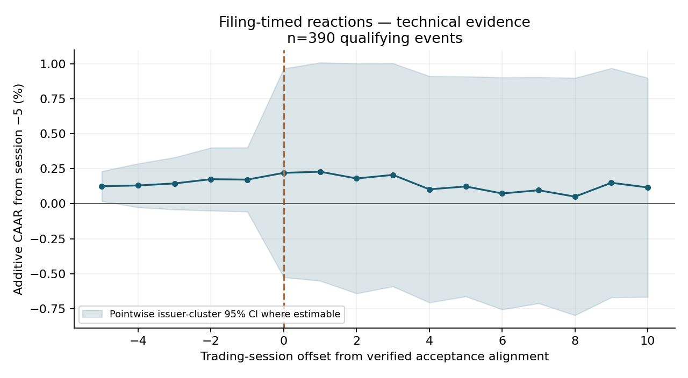

# Information Diffusion Event Study

**Do US stock prices finish reacting to earnings news on the day it is filed, or do they keep moving?**

An event study of **633 earnings-related SEC Form 8-K (Item 2.02) filings** for 30 US large-cap stocks, 2021–2025, built as a fully reproducible Python pipeline from raw SEC EDGAR data to statistical results.



## Key result

Large filing-day moves **kept going**. When a stock's abnormal return on the filing day was 2% or more in either direction, it moved a further **+0.50 percentage points in the same direction over days +1 to +5**, compared with matched large moves on non-filing days.

| Specification | Estimate (signed CAR +1 to +5, event minus control) | 95% CI |
|---|---:|---:|
| Primary: issuer-clustered | **+0.501 pp** | [+0.136, +0.866] |
| Sensitivity: quarter-clustered | +0.501 pp | [−0.010, +1.012] |

The estimate is based on 260 matched event–control pairs. The result is consistent with **gradual price adjustment** to earnings information, in the spirit of post-earnings-announcement drift. It is significant under issuer clustering but only borderline under quarter clustering (see Limitations).

## Method

1. **Universe:** 30 US large caps, six in each of five sectors (`configs/universe.csv`), with tickers mapped to SEC CIKs and checked year by year.
2. **Filings:** all original 8-Ks with an exact Item 2.02 token, pulled from the SEC EDGAR submissions API. Amendments are kept in a separate ledger.
3. **Timestamps:** acceptance times are verified against the filing index. The raw API clock disagreed with the filing index for 487 filings, and trusting it would have moved two events to the wrong trading day.
4. **Event-day alignment:** an NYSE trading calendar including early closes. Filings at or after the close, or on non-trading days, roll forward to the next session.
5. **Prices:** daily adjusted closes for each stock and SPY from Yahoo Finance (`yfinance`), with corporate-action quality flags.
6. **Expected returns:** a market model on SPY, estimated separately for each event over trading days −120 to −21 (100 returns per event). Market-adjusted returns are run as a sensitivity check.
7. **Test:** large filing-day moves (|AR(0)| ≥ 2%) are matched to comparable large moves on non-filing days (matching rules in `docs/research_design.md`). The outcome is the signed CAR over +1 to +5, where a positive value means continuation. Inference uses issuer-clustered standard errors, with quarter clustering as a sensitivity check.

## Data validation

- 633 analytical events. Each event has complete stock and SPY returns over its estimation and event windows.
- No duplicate ticker-session rows or missing adjusted closes in the 44,764-row price panel.
- **104 passing tests**. A cached rerun reproduced all 36 processed output files byte for byte.

## Limitations

- **Filing time is not the release time.** Earnings may reach the market earlier through a press release or newswire, so these are *filing-timed* reactions.
- **The universe was chosen in hindsight.** The 30 stocks are surviving large caps, so the results describe this sample rather than the whole market.
- **Dependence.** Many companies report on the same dates, and 38 events overlap with another event for the same issuer. The quarter-clustered interval crosses zero.
- **Imperfect controls.** 130 of 390 large moves had no match, and 125 of the 260 matched pairs use a control from a different year.

## Repository structure

```
configs/          stock universe and run settings
src/eventstudy/   collection, calendar, prices, market model, controls, inference, reporting
tests/            test suite
docs/             research design and source audit
reports/results/  saved aggregate results and figure
reports/live/     locally generated study outputs
```

## Local research desk

On Windows, double-click **Open Research Desk.cmd** after setup. The desk opens at
`http://127.0.0.1:8765` and includes an event explorer, timing evidence, and a run center.
See the [quick test guide](docs/QUICK_TEST.md) for the offline demo and cached reproduction.

The [saved results table](reports/results/results_table.csv) and
[inference summary](reports/results/primary_inference.json) come from the original 30-stock run.
Run-generated outputs go to `reports/live/`. Raw source snapshots and private configuration
stay local.

## Setup — Python 3.11 or 3.12

From this directory in PowerShell:

```powershell
py -3.11 -m venv .venv
.\.venv\Scripts\python.exe -m pip install -r requirements-lock.txt
.\.venv\Scripts\python.exe -m pip install --no-deps -e ".[dev]"
if (-not (Test-Path .env)) { Copy-Item .env.example .env }
# Edit .env: SEC_USER_AGENT=InformationDiffusionStudy Your Name your.actual@email.address
.\.venv\Scripts\python.exe -m eventstudy --help
.\.venv\Scripts\python.exe -m eventstudy validate --config configs/study.yaml
.\.venv\Scripts\python.exe -m pytest -q
.\.venv\Scripts\python.exe -m eventstudy demo --offline
```

Keep the configured `.env` local. The SEC requires a descriptive User-Agent with a real
contact email. On other platforms, activate the virtual environment and use `python`.

## Genuine source collection and analysis

```powershell
.\.venv\Scripts\python.exe -m eventstudy fetch --config configs/study.yaml --pilot
.\.venv\Scripts\python.exe -m eventstudy fetch --config configs/study.yaml
.\.venv\Scripts\python.exe -m eventstudy run --config configs/study.yaml
.\.venv\Scripts\python.exe -m eventstudy report --config configs/study.yaml
```

Run these commands from the project directory. The full study downloads the SEC and Yahoo
Finance source snapshots required for local reproduction.

`fetch --pilot` uses AAPL/JPM/CAT, shares the immutable source cache, and writes separate
`data/interim/pilot/` ledgers. The full fetch always requests all 30; failures do not change the
universe. `run` uses cached sources only. `fetch --offline` replays SEC/price caches. Do not
run multiple collectors concurrently because each process enforces its own two-requests-per-second limit.
403 stops that SEC host for the process; 429/5xx receive bounded retries/backoff. No access
control bypass or identity rotation. Cached files have checksum validation and are never
silently refreshed. To research a new vendor snapshot, preserve this entire project/data
snapshot and use a separately named data directory in a versioned configuration.

Exit code 0 indicates success. Code 1 indicates invalid inputs or a missing prerequisite. Code 2 indicates source failures or an empty matched sample.
A point estimate can exist while inference is unavailable for too few issuer clusters.

## Author

Karol S John, B.Sc. Economics, SRM Institute of Science and Technology · [LinkedIn](https://www.linkedin.com/in/karol-john-300665344/)
