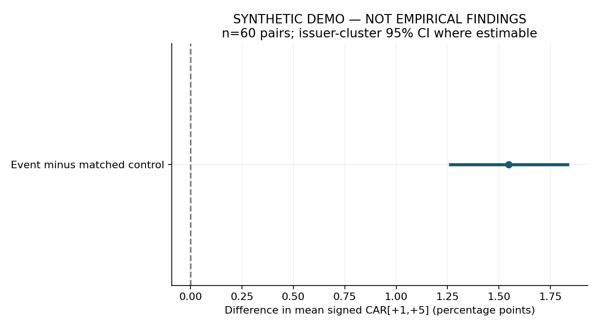
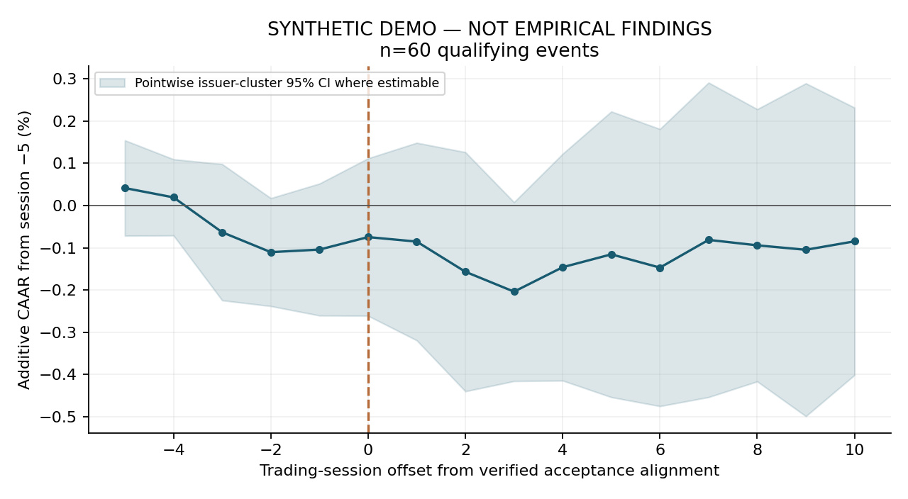
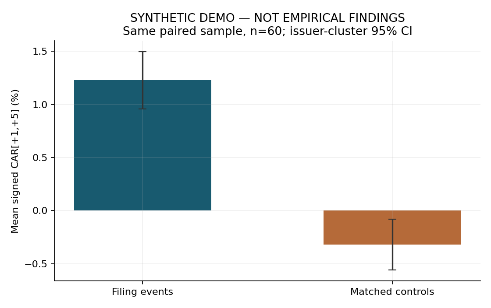
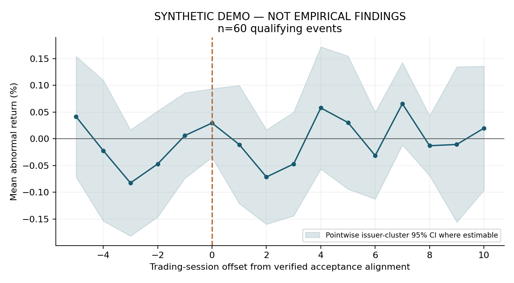
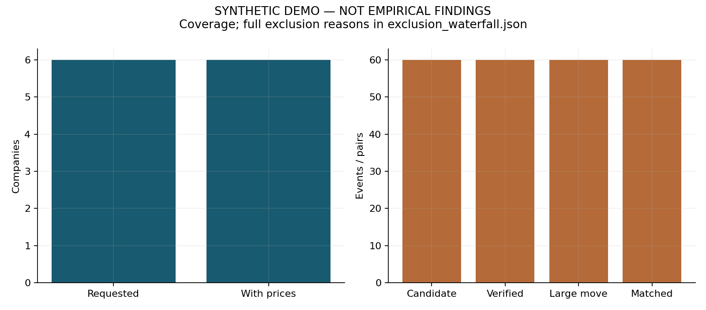

# SYNTHETIC DEMO — NOT EMPIRICAL FINDINGS

Generated technical evidence for Karol's audit. Not final publication prose.

Run status: **analysis_available**.

| Count | Observed |
|---|---:|
| analytical_events | 60 |
| candidate_events | 60 |
| companies_requested | 6 |
| companies_with_prices | 6 |
| excluded_events | 0 |
| failed_operations | 0 |
| filings_discovered | 60 |
| included_large_move_events | 60 |
| matched_controls | 60 |
| price_quality_issues | 0 |
| release_timing_verified | 0 |
| unmatched_events | 0 |
| verified_candidates_in_research_sessions | 60 |
| verified_events | 60 |

Primary output: `primary_inference.json`; sensitivities: `robustness.json`.
Mean paired difference (percentage points): 1.5481817993488074.
Issuer inference: {"ci95_pp": [1.2564566519558638, 1.8399069467417508], "clusters": 6, "df": 5, "p_one_sided": 1.8975491176720038e-05, "p_two_sided": 3.7950982353440076e-05, "se_pp": 0.11348603781008622, "status": "estimated_few_clusters", "t_stat": 13.642046451032328}.

No event sample or significance is inferred when sources or cluster counts are insufficient.
A date on a release does not establish its time. Daily returns include unrelated within-day trading.
Threshold selection is retrospective. The selected surviving-stock universe limits generalization.
Quarter-cluster sensitivity and issuer bootstrap do not eliminate all dependence or selection bias.

## Evidence figures

